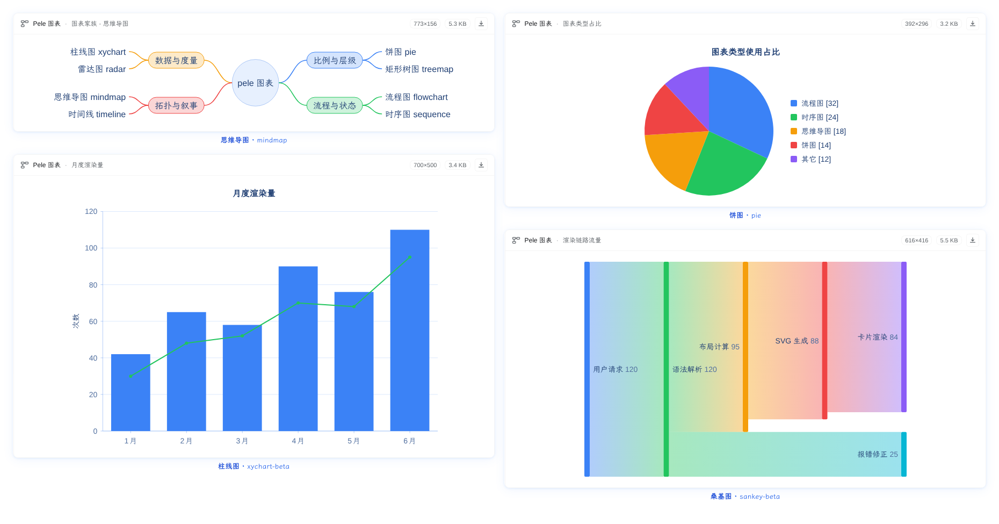
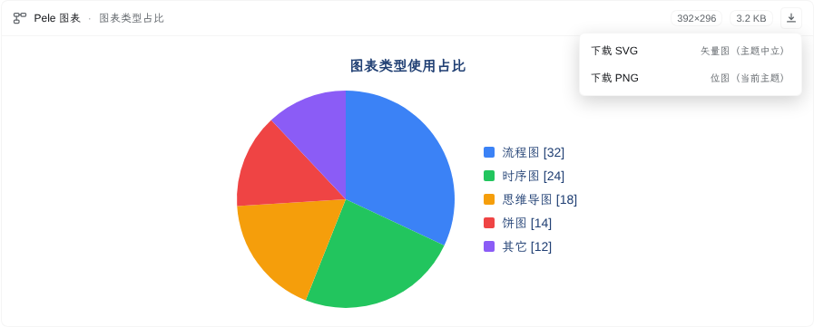
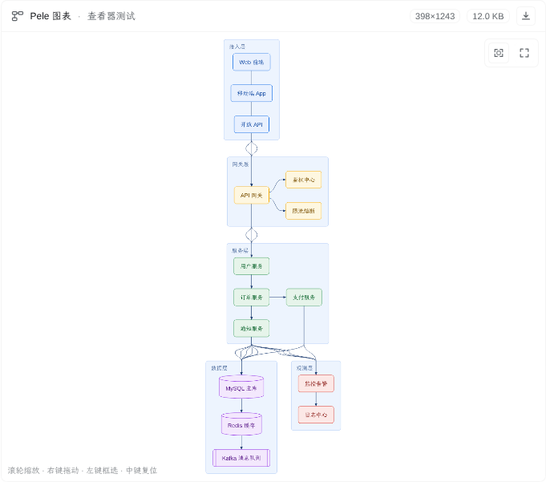
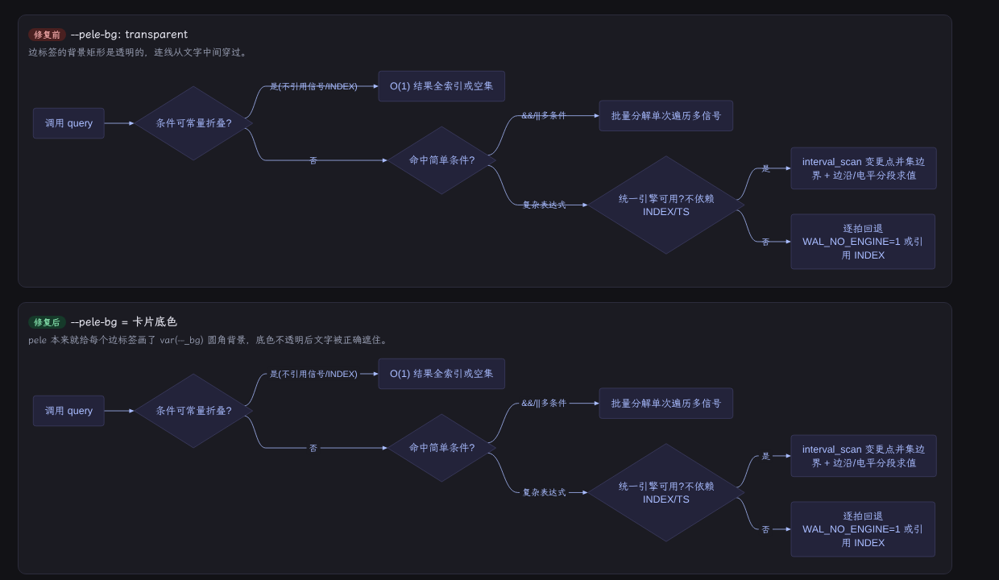
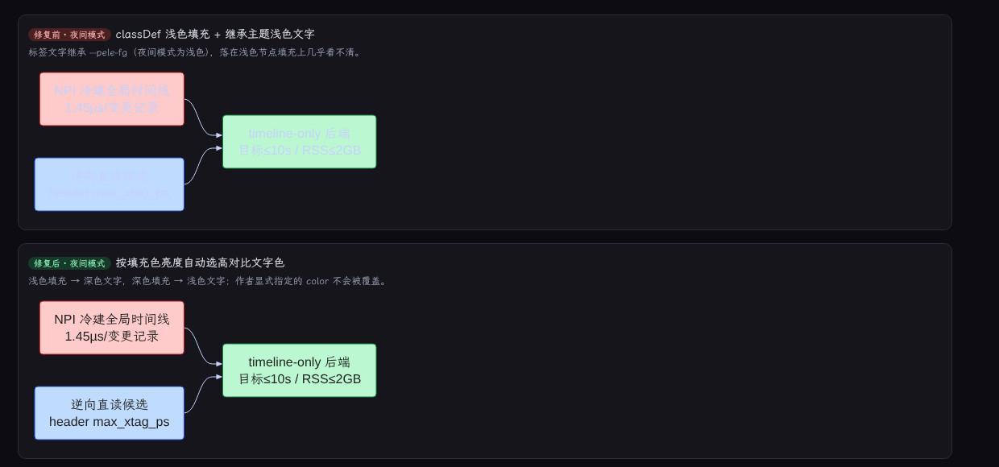

<div align="right">

[简体中文](README.md) · **English**

</div>

# dsh-pele

[](https://github.com/deepseek-ai/deepseek-harness)

Draw diagrams in **DeepSeek Harness (DSH)** sessions with [pele](https://github.com/obsidianmd/pele) (a Mermaid → SVG renderer). The model calls the `pele_draw` tool with Mermaid source; the Host renders it to SVG with pele (keeping the SVG out of the model context), and the Web client turns that tool call into an **inline diagram card**. The card offers **SVG** / **PNG** downloads from its top-right corner, and the plugin never writes workspace files.

- Target profile: `web` (DSH 0.2.1-rc.2)
- Version: **0.1.1** (open-source release; not published to npm yet — install from a local directory or Git)
- Repository: <https://github.com/hesheng01/dsh-pele>
- Plain JS, no build step, no runtime npm dependencies (pele is vendored under `plugin/vendor/` with its MIT license)

## Showcase



After the model calls `pele_draw`, the diagram appears directly in the conversation as a card: title, size / byte badges and the inline SVG (the picture above shows a mindmap, a pie chart, a bar/line chart and a sankey diagram rendered in the same session). Series colors use a saturated palette (blue / green / amber / red / violet / cyan / pink / lime) instead of the near-black brand color; text, nodes and edges carry a light blue tint for a cleaner look.

The download button at the card's top-right opens two options:



- **Download SVG**: a theme-neutral vector image (pele's light fallback colors) that renders everywhere;
- **Download PNG**: a bitmap that follows the current light/dark theme, rasterized at 2x with the card background — what you see is what you get.

Complex diagrams can also be inspected right in the card:



- **Mouse wheel** up/down: zoom in / out around the cursor;
- **Right-drag**: pan;
- **Left-drag**: draw a box; releasing zooms that box to fill the window;
- **Middle-click / double-click**: reset (fit to window);
- The **fullscreen button** at the top-right expands the diagram over the current DSH page (Esc or the × closes it), with the same interactions available (see `deliverables/effect-fullscreen.png`).

Edge-label background fix (top: `--pele-bg: transparent`, lines cut through the text; bottom: card background, labels mask the lines):



When `classDef`/`style` gives a node a fixed fill color, its label text now picks a high-contrast color based on that fill's luminance (in dark mode, light-filled nodes no longer render light text on light fill):



More demos: `deliverables/traversal-gallery.png` (33 diagram types) and `deliverables/pele-vs-mermaid/` (comparison with mermaid.js, rendering-process GIF).

## Layout

```text
dsh-pele/
├── plugin/                     # the installable DSH bundle (plugin_manager install_bundle target)
│   ├── index.js                # Host half: pele_draw tool (render / presentationMeta / prompt / error hints)
│   ├── render.js               # pure render layer (vendored pele + sanitizing + error messages), unit-testable
│   ├── client.js               # browser half: tool.call.toolview (key=pele_draw) card + interactive viewer + SVG/PNG download menu
│   ├── cordis.patch.yml        # bundle patch: inserts the id=pele row + default config
│   ├── package.json            # dsh.bundle.patch + dsh.client(platform=web)
│   ├── locale/{zh,en}.json     # Plugin Manager display metadata
│   ├── icon.svg                # plugin icon (original)
│   └── vendor/pele.js          # vendored pele 1.10.0 ESM build (MIT, see pele.LICENSE)
├── scripts/
│   ├── selftest.mjs            # offline render self-test: 23 diagram types + error paths (incl. mindmap keyword quirk)
│   ├── card-ssr-test.mjs       # card SSR test: registration contract + three phases + sanitizing + download entry + viewer controls
│   ├── build-gallery.mjs       # builds the visual index page from the 33 traversal results
│   └── build-render-demo.mjs   # builds the "pele vs mermaid.js / rendering process" demo pages
├── research/                   # pele API / client contract research, 33-type corpus and traversal report
├── deliverables/               # screenshots and demo assets (card showcase, download menu, interactive viewer, gallery, comparison, GIF)
├── docs/icon-180.png           # market tile icon (180x180 PNG)
├── CHANGELOG.md
└── LICENSE                     # MIT
```

## Install / uninstall

```bash
# 1) Get the repository and enter it (example)
git clone https://github.com/hesheng01/dsh-pele.git dsh-pele
cd dsh-pele

# 2) Install (plugin_manager runs pnpm to update the profile dependency and bundle selection)
# From a DSH session:
#   action=install_bundle, target=<absolute-path>/dsh-pele/plugin
#
# CLI equivalent:
dsh plugin --profile web add <absolute-path>/dsh-pele/plugin
```

- The first installation needs a Host restart; after that, edits to `plugin/*.js` are picked up when the Plugin Manager recomposes the profile (or by the HMR watcher directory).
- Uninstall: `plugin_manager action=remove_bundle, target=dsh-pele` (and remove the profile dependency).

## Usage

Ask the model to draw, for example:

> Use pele to draw a login flowchart, title "Login flow".

The model then calls:

```jsonc
pele_draw({
  "diagram": "flowchart LR\n  A[Start] --> B{Logged in?}\n  B -->|yes| C[Home]\n  B -->|no| D[Login]",
  "title": "Login flow"    // optional: card title and download file name
})
```

The tool result contains only a summary (type / size / bytes). **The SVG never enters the model context**: it is persisted on the `tool/result` event through `output.presentationMeta` (`meta` field), read by the client card and rendered inline. When the user needs a file, they download it from the card's top-right button; the plugin writes nothing to the workspace.

- Supports all 33 Mermaid 12.1 diagram types of pele 1.10.0: flowchart, sequenceDiagram, classDiagram, stateDiagram-v2, erDiagram, gantt, pie, quadrantChart, xychart-beta, mindmap, timeline, journey, gitGraph, sankey-beta, block-beta, packet-beta, kanban, architecture-beta, radar-beta, treemap, info, agentflow, usecase, railroad, treeView, venn, cynefin, wardley, swimlane, ishikawa, eventmodeling, C4, requirementDiagram.
- Syntax errors return Mermaid line/column and a snippet so the model can fix and retry.
- Cards follow the DSH light/dark theme: pele's `--pele-*` color variables are mapped to `--dsw-alias-*` theme tokens, so a single SVG never needs re-rendering.
- Card contents: title/type, size and byte badges, an interactive SVG, plus a download menu for **Download SVG** (theme-neutral vector) and **Download PNG** (current theme, 2x, card background); wheel zoom, right-drag pan, left-drag box zoom, middle-click reset and fullscreen view are supported.

## System prompt

When `config.prompt` is `true` (default), the plugin injects a `## Diagrams (pele_draw)` section into the agent's system prompt, covering: when to call `pele_draw`, that the first line must be a diagram-type keyword, one call per diagram, that mindmap node text must not start with `mindmap`, that syntax errors should be fixed using the reported line numbers, and that the model should not paste SVG or the whole Mermaid source into its reply. The text is static (KV-cache friendly) and empty when the tool is not visible to an agent.

> Note: in mindmaps, node text starting with `mindmap` hits a known pele/Mermaid lexer quirk (`Mindmap` / `MINDMAP` are affected too): the word is tokenized as the `MINDMAP` keyword and the parse fails with `got 'MINDMAP'`. Write "mindmap overview" instead, quote it (`"mindmap"`), or use the `mm[mindmap]` form.

## Configuration (override the `pele` row in the web profile's `cordis.patch.yml`)

```yaml
- id: pele
  config:
    maxSourceBytes: 200000           # max Mermaid source bytes
    maxSvgBytes: 1500000             # max SVG output bytes (rejected above)
    maxInlineSvgBytes: 512000        # max SVG bytes inlined into the card (larger shows a "too large" hint)
    timeoutMs: 20000                 # tool call timeout
    prompt: true                     # inject the pele_draw system-prompt section
```

## Verification

| Item | Result | How |
| --- | --- | --- |
| Offline render self-test | 23/23 passed + 4 error paths + contrast assertions | `node scripts/selftest.mjs` |
| Card SSR test | 14/14 passed (download entry, viewer controls, closed menu, no-SVG case) | `node scripts/card-ssr-test.mjs` |
| 33-type corpus traversal | 33/33 diagram types ok, 0 failures | `node scripts/build-traversal-report.mjs` (same render path as `pele_draw`), see `research/traversal-report.json` |
| Visual check | All 33 diagram types render correctly | `deliverables/traversal-gallery.png` (built from the 33 real SVGs) |
| Client registration | `pele_draw` card active in `tool.call.toolview` | live `cordis_inspect_query` |
| Download feature (real browser) | SVG (5.4 KB) and PNG (1546×312, 2x) exported successfully | clicked the card menu in a temporary instance; checked file headers/dimensions |
| Interactive viewer (real browser) | wheel zoom / middle-click reset / right-drag pan / left-drag box zoom / fullscreen + Esc all pass | drove real mouse events and read the viewer transform in a temporary instance |

Re-run:

```bash
npm test            # offline render self-test (= node scripts/selftest.mjs)
npm run test:ssr    # card SSR test (needs react/react-dom under .probe/ssr)
npm run gallery     # build the visual index page from research/traversal-report.json
npm run demo        # build the pele vs mermaid.js and rendering-process pages
```

## Implementation notes

1. **Why the SVG goes through `presentationMeta`**: SVGs are usually a few KB to tens of KB; putting them into the model context would waste tokens and disturb reasoning. `meta` is persisted on the session event for the client renderer only. The canonical value keeps an `svg` field, while `render()` emits just the summary.
2. **Theming**: pele SVGs take every color from `var(--_x)` → `var(--pele-x, fallback)`. The card overrides `--pele-*` with `--dsw-alias-*` on its container, so light/dark themes apply without re-rendering. In particular `--pele-bg` must map to the **card background**, not `transparent`: pele paints a `fill=var(--_bg)` rectangle behind every edge label, and a transparent value lets connector lines run through the label text (see the before/after in `deliverables/effect-label-background.png`).
3. **Security**: both Host and Client sanitize the SVG (strip `<script>` / `<foreignObject>` / inline events / `javascript:` links); the Client requires the string to start with `<svg` and stay under 600 KB; the plugin writes no files — export only happens in the browser, triggered by the user.
4. **Download**: SVG exports the original SVG rendered by the Host. PNG clones the currently rendered `<svg>` in the browser, bakes the inherited theme CSS variables into inline values, and draws it to a canvas at 2x (falling back for huge edge/area sizes); the background is the card background.
5. **Determinism**: every diagram gets a `sha1`-derived `idPrefix` (note: pele's render output does not use it in 1.9/1.10, so duplicate element ids are possible on one page — see limitations).
6. **Tool schema**: `output.schema` uses the dsh-tools "value schema DSL" (required flags on properties), not raw JSON Schema.
7. **Label contrast on fixed fills**: models often use `classDef` to give nodes a fixed fill (e.g. `fill:#fecaca`), while label text inherits the theme text color — in dark mode, light fills plus light text become nearly unreadable. After rendering, the Host injects a high-contrast label color based on the fill's relative luminance (an author-specified `color` is respected); before/after in `deliverables/effect-dark-contrast.png`.

## Known limitations

- The Host uses pele's built-in approximate text-width table (no browser fonts); a client rendering the same SVG with a very different font stack may slightly overflow long labels — the card pins `--pele-font` to the same font stack the Host uses.
- Very wide diagrams scale down with `max-width:100%`; the card body scrolls for large diagrams.
- Downloaded SVGs use pele's light fallback colors (theme-neutral, visible anywhere); only PNG follows the current light/dark theme.
- After a turn settles, DSH folds earlier tool rows into the turn-process group (host behavior, not a plugin issue).
- Multiple pele SVGs on one page can repeat internal element ids (e.g. `U`/`A`/`D`): the renderer ignores our `idPrefix` (verified with 1.9.0/1.10.0). It does not affect display today and is recorded as a known limitation.
- The interactive viewer targets mouse input (wheel zoom, right-drag pan, left-drag box zoom); trackpad pinch and touch gestures are not specially handled.
- The contrast correction only covers "node fill + label text"; an explicitly specified text color is left untouched.

## License

- This plugin: MIT, see [`LICENSE`](LICENSE).
- Vendored `pele` 1.10.0: MIT, copyright kepano / obsidianmd, see [`plugin/vendor/pele.LICENSE`](plugin/vendor/pele.LICENSE).
